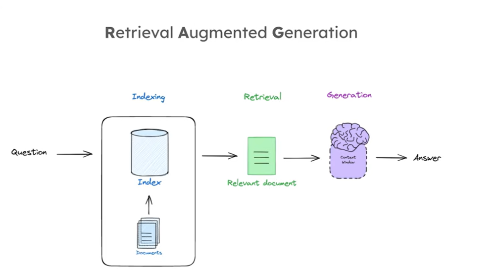
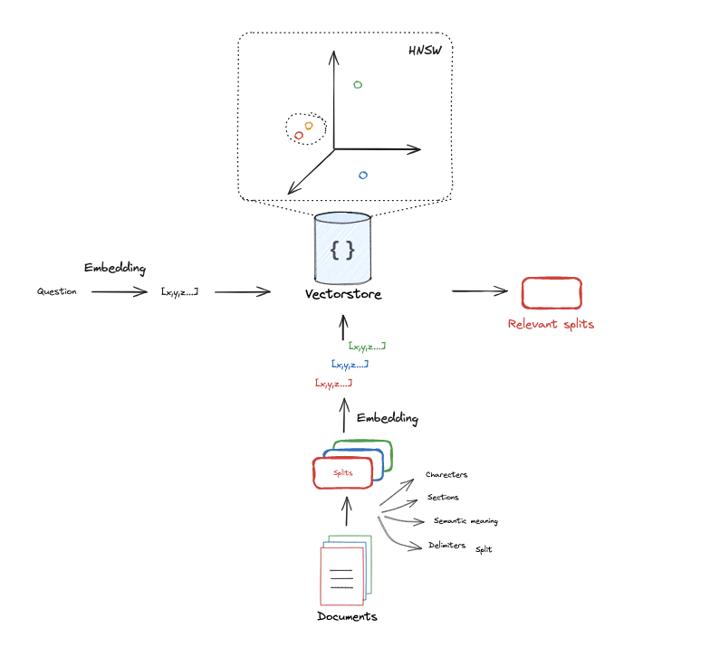
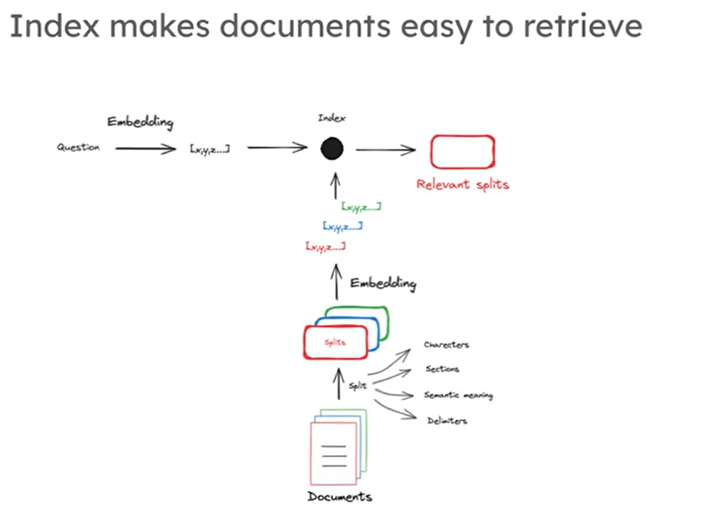
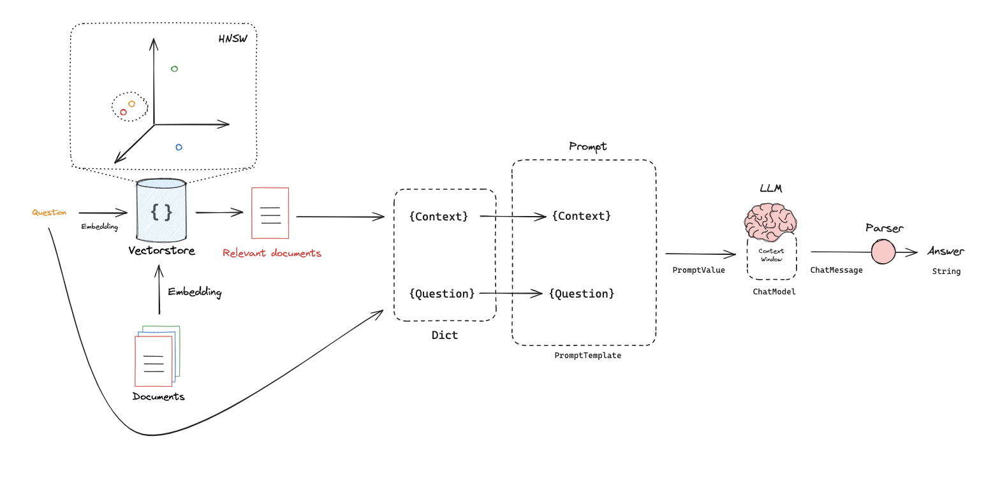
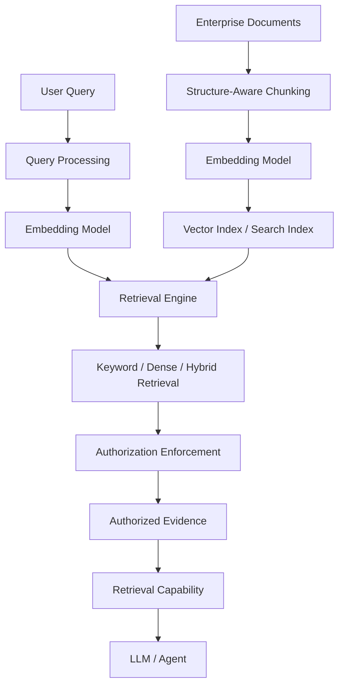
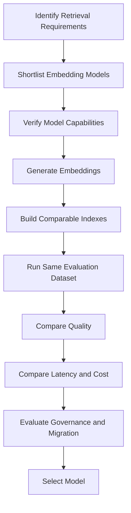
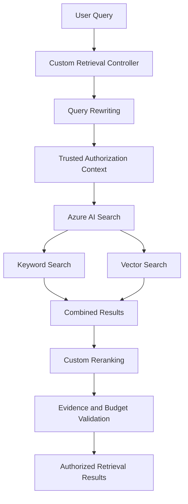
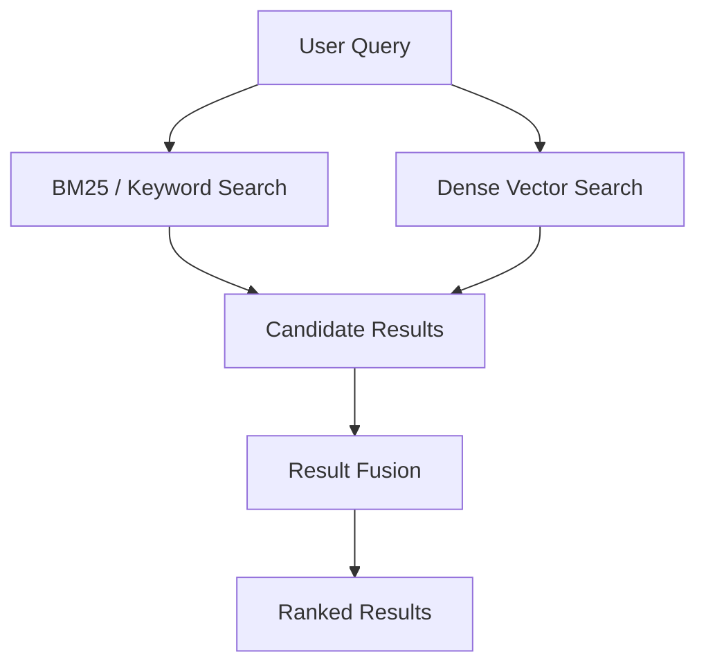
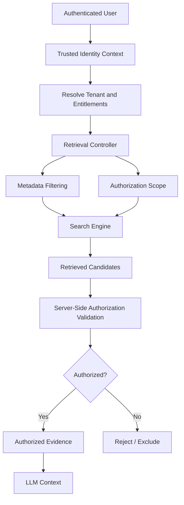
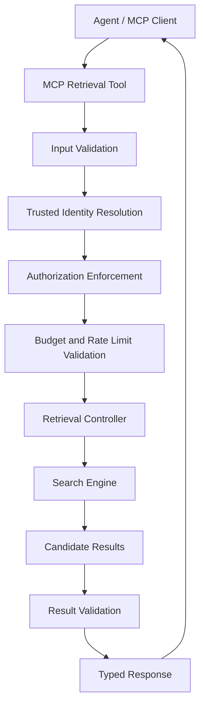

Part 1 RAG : Overview 


Part 2: Indexing


Part 3: Retrieval


Part 4: Generation


# Week 8 – Day 1: Advanced RAG Architecture
## Final Revision Notes — Embeddings, Retrieval Engines, Retrieval Strategy and Capability Contracts

**Learning Path:** AI Platform & Agentic Systems Architect  
**Phase:** Phase 2 — Context Engineering  
**Week:** 8 — Advanced RAG Architecture  
**Day:** 1  
**Status:** Learning Complete  
**Focus:** Block 2 and Block 3

---

# 1. Day 1 Architecture Overview

Day 1 establishes five important architectural decisions:

1. Chunking determines how documents are divided into retrievable units.
2. Embeddings determine how semantic meaning is represented.
3. Retrieval engines determine where and how information is searched.
4. Retrieval strategies determine how relevant evidence is discovered and ranked.
5. Capability contracts determine how retrieval is safely exposed to other systems.

The overall flow:



---

# BLOCK 2 — EMBEDDING MODELS AND RETRIEVAL ENGINES

## 2. Embedding Models — Fundamentals

### 2.1 What is an embedding?

An embedding model converts text or other supported input into a numerical vector.

The vector represents semantic information in a mathematical space.

Example:

- Query: "How can I recover my account?"
- Document: "Steps for resetting account credentials."

The wording is different, but the semantic meaning is similar.

An embedding model attempts to represent that similarity numerically.

### 2.2 Why do we need embeddings?

Traditional keyword search depends heavily on matching words or terms.

Embedding-based retrieval can find semantically similar content even when the exact words differ.

For example:

| Query | Document | Keyword search | Dense retrieval |
|---|---|---|---|
| Reset password | Recover account credentials | May miss | May retrieve |
| Incident reporting | Event notification procedure | May miss | May retrieve |
| Policy ID QHSE-102 | QHSE-102 procedure | Strong | Depends on semantic representation |
| Database connection timeout | SQL connectivity failure | Depends on exact terms | May retrieve |

Important: Dense retrieval is not automatically better than keyword search. Both have different strengths.

## 3. Embedding Model Selection

### 3.1 Important selection dimensions

An architect should evaluate embedding models across the following dimensions.

| Dimension | What to evaluate | Why it matters |
|---|---|---|
| Retrieval quality | Recall@K, Precision@K and ranking quality | Determines retrieval effectiveness |
| Embedding dimensions | Vector size, such as 768, 1536 or 3072 | Impacts storage, indexing and search cost |
| Input limits | Maximum input tokens or content size | Determines chunking constraints |
| Language support | Supported languages and domain vocabulary | Important for enterprise content |
| Latency | Embedding generation time | Impacts ingestion and query performance |
| Throughput | Requests and tokens processed | Impacts scalability |
| Pricing | Cost per token or request | Impacts operating cost |
| Data governance | Residency, retention and processing | Impacts enterprise compliance |
| Compatibility | Model and vector-space compatibility | Impacts retrieval correctness |
| Migration | Re-embedding and index rebuilding | Impacts future operational effort |

### 3.2 Model comparison principle

A larger embedding dimension or more expensive model does not automatically produce better retrieval.

Example:

| Attribute | Model A | Model B |
|---|---:|---:|
| Dimensions | 1,536 | 3,072 |
| Cost | Lower | Higher |
| Retrieval quality | Must be measured | Must be measured |
| Storage | Lower relative footprint | Higher relative footprint |
| Selection | Benchmark required | Benchmark required |

Do not select Model B just because it has more dimensions.

Use your own evaluation dataset to determine which model produces better retrieval results.

### 3.3 Model selection workflow



### 3.4 Critical architectural rule

Document embeddings and query embeddings must belong to compatible embedding spaces and configurations.

If the corpus was indexed using Model A, you cannot arbitrarily generate query vectors using an incompatible Model B and expect valid similarity results.

A model migration may require:

1. Generate new document embeddings.
2. Rebuild or version the vector index.
3. Validate retrieval quality.
4. Switch query embeddings to the compatible model.
5. Retain a rollback strategy where necessary.

### 3.5 Important distinction: Embeddings versus reranking

Embeddings are generally used for efficient initial candidate retrieval.

Reranking is a separate stage that evaluates the relevance of retrieved candidates more deeply.

We will study reranking in Day 2.

---

## 4. Retrieval Engines — Managed versus Custom

### 4.1 Understand the three architectural layers

Do not confuse these concepts:

| Layer | Responsibility |
|---|---|
| Search/retrieval engine | Indexes and searches content |
| Vector database/search index | Stores searchable representations and metadata |
| Retrieval orchestration | Controls query processing, retrieval strategy, filtering, reranking and execution |

These responsibilities can be provided by one managed service or distributed across multiple components.

### 4.2 Managed retrieval

A managed service provides search/indexing infrastructure and associated capabilities.

Example: Azure AI Search.

Typical capabilities may include:

- Document indexing.
- Keyword search.
- Vector search.
- Hybrid search.
- Metadata filtering.
- Semantic ranking, depending on configuration and availability.

Advantages:

- Lower infrastructure management.
- Faster implementation.
- Managed scaling and service operations.
- Cloud ecosystem integration.

Trade-offs:

- Service-specific constraints.
- Pricing and capacity dependencies.
- Potential vendor lock-in.
- Less control over certain internal search operations.

### 4.3 Custom retrieval

A custom implementation assembles retrieval capabilities using components selected and operated by your team.

Possible components:

- Custom ingestion.
- Embedding provider.
- Vector database.
- Keyword search engine.
- Query rewriting.
- Retrieval controller.
- Reranker.
- Evaluation framework.

Advantages:

- Greater architectural control.
- Custom ranking and orchestration.
- More flexibility across providers.

Trade-offs:

- Higher engineering effort.
- More operational responsibility.
- More complex scaling and maintenance.
- More integration and failure-management work.

### 4.4 Hybrid architecture — important enterprise pattern

Managed versus custom is not an either/or decision.

Consider this architecture:



In this example:

**Managed components:**
- Azure AI Search.
- Indexing.
- Keyword search.
- Vector search.

**Custom components:**
- Retrieval controller.
- Query rewriting.
- Application-specific authorization.
- Reranking orchestration.
- Budget management.
- Monitoring and decision logic.

This is a hybrid architecture.

### 4.5 When should we choose managed versus custom?

| Requirement | Recommended direction |
|---|---|
| Minimal operational overhead | Managed |
| Standard enterprise hybrid search | Managed |
| Fast implementation | Managed |
| Highly specialized retrieval logic | Custom orchestration |
| Multiple retrieval providers | Custom orchestration |
| Complex domain-specific ranking | Custom orchestration |
| Strong provider portability requirements | Custom abstraction over managed or custom engines |

**Architect's takeaway:**

Prefer managed infrastructure where it satisfies requirements. Build custom orchestration only where the application genuinely needs additional control.

---

# BLOCK 3 — RETRIEVAL STRATEGY, FILTERING, AUTHORIZATION AND CAPABILITY CONTRACTS

## 5. Retrieval Strategies

There are three foundational retrieval strategies.

### 5.1 Keyword Retrieval — BM25

BM25 is a ranking algorithm used in lexical information retrieval.

It evaluates how well query terms match document terms, considering factors such as term frequency, inverse document frequency and document length.

Best suited for:

- Exact identifiers.
- Policy numbers.
- Product codes.
- Technical error messages.
- Specific names and phrases.

Example:

Query: `QHSE-102`

Keyword retrieval can be particularly useful because the exact identifier matters.

### 5.2 Dense Retrieval

Dense retrieval uses embeddings to find semantically similar content.

Best suited for:

- Natural-language questions.
- Different wording with similar meaning.
- Conceptual queries.
- Synonym-rich content.

Example:

Query: `How do I report an unsafe condition?`

Relevant document:

`Procedure for notification and recording of workplace hazards.`

The wording differs, but the semantic relationship may be strong.

### 5.3 Hybrid Retrieval

Hybrid retrieval combines lexical and dense retrieval.



Advantages:

- Exact-term matching.
- Semantic matching.
- Better coverage for mixed query types.

A fusion algorithm such as Reciprocal Rank Fusion (RRF) can combine ranked lists.

Example:

\[
RRF(d)=\sum_{r \in R}\frac{1}{k+rank_r(d)}
\]

Here:

- \(d\) = document.
- \(R\) = retrieval result lists.
- \(rank_r(d)\) = rank of document in a result list.
- \(k\) = smoothing constant.

Do not assume hybrid always wins. Benchmark keyword, dense and hybrid retrieval against the same evaluation dataset.

---

## 6. Metadata Filtering versus Authorization

This is one of the most important security distinctions in enterprise RAG.

### 6.1 Metadata filtering

Metadata filtering narrows the search space using document attributes.

Examples:

- Document type = policy.
- Department = QHSE.
- Country = India.
- Document version = current.
- Created date = within a specified range.

Purpose: improve retrieval relevance and reduce unnecessary candidates.

### 6.2 Authorization filtering

Authorization determines whether the authenticated user or agent is permitted to access the document.

Examples:

- User belongs to a permitted department.
- User has access to a particular tenant.
- User has permission to read a confidential document.
- User has access to a restricted project.

Purpose: enforce security and data access policy.

### 6.3 Critical difference

| Metadata filtering | Authorization |
|---|---|
| Improves search relevance | Enforces access control |
| Can use document attributes | Uses trusted identity and policy |
| May be user-selected | Must be server-enforced |
| Not a security boundary by itself | Security boundary |

A document being relevant does not mean the user is authorized to access it.

### 6.4 Secure enterprise retrieval flow



### 6.5 Security rules

1. Do not trust authorization decisions made by the LLM.
2. Do not accept arbitrary user-supplied roles as proof of authorization.
3. Resolve identity from trusted authentication context.
4. Apply authorization at the trusted retrieval/service boundary.
5. Prefer server-side entitlement filters during search.
6. Validate results before exposing them to the LLM or caller.
7. Fail closed when identity or policy evaluation is unavailable.
8. Account for permission revocation and document deletion.

**Most important rule:**

Unauthorized content must never reach the LLM context.

---

## 7. Retrieval as a Capability

Retrieval should not be exposed as an unrestricted search function.

It should be exposed as a governed capability with an explicit contract.

This becomes particularly important when retrieval is exposed through MCP.

### 7.1 What is a capability contract?

A capability contract defines:

- What the capability accepts.
- What it returns.
- Who can invoke it.
- What permissions are required.
- What execution limits apply.
- How errors are reported.
- What operational guarantees exist.

### 7.2 Minimum MCP retrieval contract

| Contract area | Responsibility |
|---|---|
| Input schema | Query, top-K and supported filters |
| Output schema | Text, source ID, URI, version, citations and scores |
| Authorization | Trusted identity and permission enforcement |
| Resource limits | Maximum results and payload size |
| Execution limits | Deadline, timeout and bounded attempts |
| Error handling | Typed errors and failure details |
| Observability | Correlation ID, trace and retrieval metadata |

### 7.3 Example request

```json
{
  "query": "What is the incident reporting procedure?",
  "top_k": 5,
  "filters": {
    "document_type": "policy"
  }
}
```

The authenticated user identity and authorization context should be derived from trusted server-side context rather than accepted as authoritative fields in an LLM-generated request.

### 7.4 Example response

```json
{
  "status": "success",
  "results": [
    {
      "text": "Incidents must be reported through...",
      "source_id": "policy-102",
      "source_uri": "internal://policies/102",
      "document_version": "3.0",
      "score": 0.91,
      "citation": "Section 4.2"
    }
  ],
  "correlation_id": "request-123"
}
```

This is an illustrative contract, not a fixed MCP standard response schema.

### 7.5 Execution boundaries

A retrieval capability must be bounded.

Important controls:

- Maximum top-K.
- Maximum response payload.
- Maximum execution time.
- Maximum retrieval attempts.
- Token budget.
- Concurrency limits.
- Rate limits.
- Retry classification.
- Explicit stop reasons.

Example:

| Constraint | Illustrative value |
|---|---:|
| Maximum top-K | 10 |
| Retrieval deadline | 2 seconds |
| Maximum adaptive attempts | 2 |
| Maximum response size | Defined by application |
| Retry policy | Bounded and error-specific |

These values must be derived from measured service requirements rather than treated as universal defaults.

### 7.6 Why typed failures matter

Avoid returning an empty result for every failure.

Differentiate:

- `INVALID_REQUEST`
- `UNAUTHENTICATED`
- `FORBIDDEN`
- `TIMEOUT`
- `RATE_LIMITED`
- `RETRIEVAL_UNAVAILABLE`
- `BUDGET_EXCEEDED`
- `NO_RELEVANT_EVIDENCE`

The consuming agent should be able to decide whether to:

- Stop.
- Retry.
- Ask the user to clarify.
- Use an alternative authorized capability.
- Report a service failure.

### 7.7 Retrieval capability architecture



**Architect's takeaway:**

A retrieval capability must be secure, bounded, observable, reusable and predictable.

---

# 8. Key Architectural Decision Matrix

| Decision | Recommended approach | Decision evidence |
|---|---|---|
| Legal document chunking | Structure-aware | Clause and section preservation |
| Embedding model | Evaluation-driven selection | Own retrieval benchmark |
| Retrieval engine | Managed where sufficient | Operational requirements |
| Orchestration | Custom where needed | Domain-specific control |
| Retrieval strategy | Keyword, dense or hybrid | Recall and ranking metrics |
| Authorization | Trusted server-side enforcement | Security tests |
| MCP exposure | Explicit capability contract | Contract and failure tests |

---

# 9. Active Recall — Day 1

You should be able to answer these without consulting the notes:

1. Why is a larger embedding dimension not automatically better?
2. What happens if document and query embeddings use incompatible models?
3. What is the difference between a vector database and a retrieval controller?
4. Why can Azure AI Search and custom retrieval orchestration coexist?
5. When does BM25 outperform dense retrieval?
6. Why can hybrid retrieval be useful?
7. What is the difference between metadata filtering and authorization?
8. Why must authorization be enforced independently of the LLM?
9. What is a retrieval capability contract?
10. Why should retrieval attempts and execution time be bounded?

---

# 10. Day 1 Final Learning Outcome

After completing Day 1, I should be able to:

- Explain embedding architecture.
- Defend an embedding model selection using evaluation evidence.
- Compare managed, custom and hybrid retrieval architectures.
- Select keyword, dense or hybrid retrieval for a given scenario.
- Design trusted document-level authorization.
- Define a bounded MCP retrieval capability contract.

**Day 1 status: Learning Complete.**

**Next: Week 8 — Day 2: Reranking, Adaptive Retrieval and Bounded Self-Correction.**